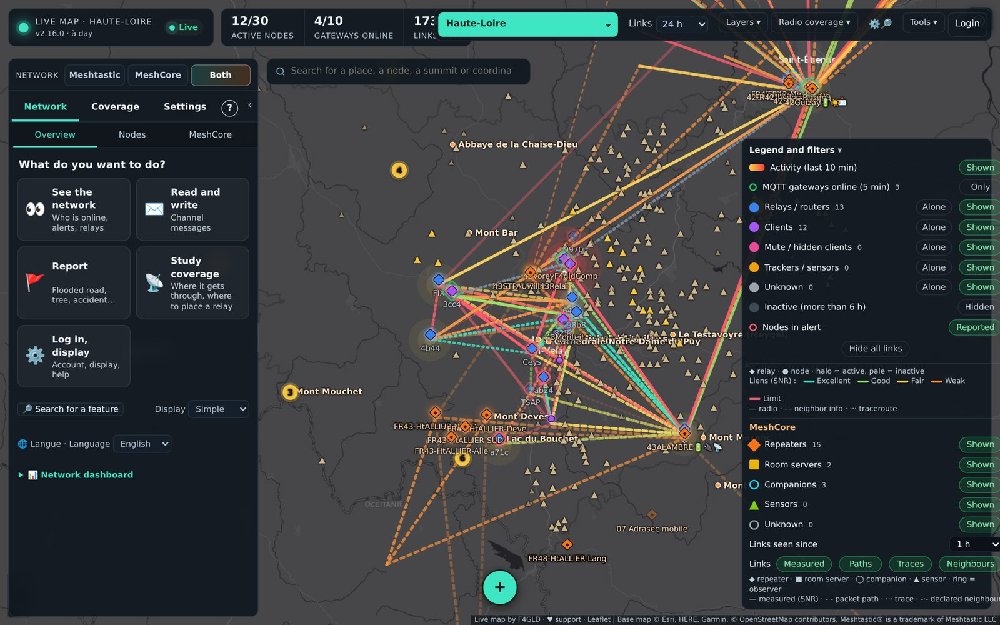
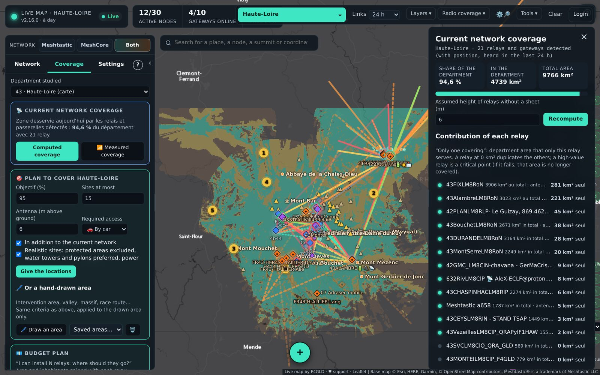
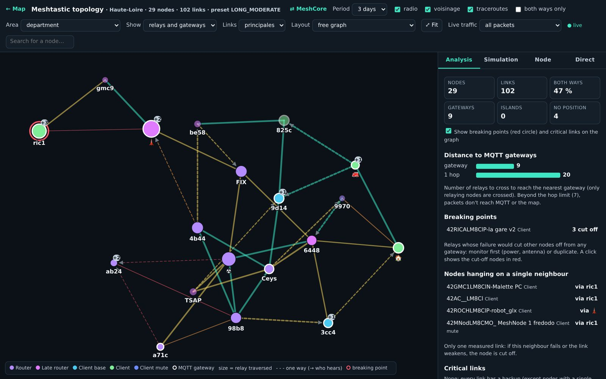
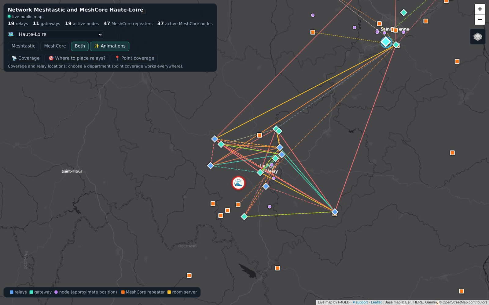
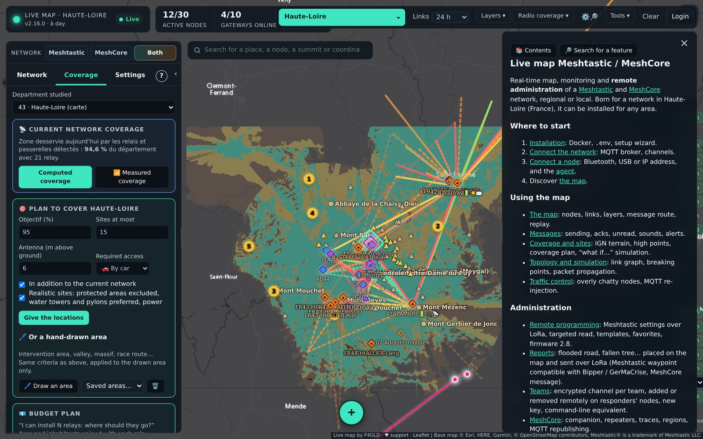

# Live mesh map — US edition

**Current version: 1.0.0**

Self-hosted **live map, monitoring and remote administration** for [Meshtastic](https://meshtastic.org) and [MeshCore](https://meshcore.co.uk) networks in the **United States**. It listens to your MQTT broker and/or a radio node, decodes packets, keeps the history, estimates radio coverage from USGS terrain and lets you program your nodes over LoRa.

This is a US adaptation of [live-mesh-map-world](https://github.com/sauveteur71/live-mesh-map-world) by F4GLD (itself the world edition of the French [carte-live-meshtastic](https://github.com/sauveteur71/carte-live-meshtastic)). Same program, rebuilt around US counties, USGS data, 915 MHz defaults and imperial units.

📖 **Documentation:** [`wiki/`](wiki/Home.md) (also served as the built-in help in the map).



| Coverage computed from terrain | Link graph |
|---|---|
|  |  |
| **Public map** | **Built-in help** |
|  |  |

*Screenshots from the original project (a network in France); the US edition looks the same with US data.*

## What changed for the US

| | Original (France / world) | US edition |
|---|---|---|
| Map area | French département, or a 1° square | **US county** (5-digit FIPS, e.g. `04013` Maricopa County, AZ), picked by state; neighbouring counties; **states** instead of French regions |
| Terrain | IGN RGE ALTI (France), Copernicus elsewhere | **USGS 3DEP** (The National Map), Copernicus as fallback and outside the US |
| Link profiles | IGN elevation line | **USGS 3DEP** samples, Open-Meteo fallback |
| Base maps | IGN plan / photos / shading | **USGS Topo**, **USGS Imagery**, **USGS shaded relief** |
| Place search | Photon (French) + IGN addresses | Photon (English) + **US Census address geocoder** |
| Towns and population | French government API (communes) | OpenStreetMap places (Census populations), clipped to the county |
| High-point names | French government API | **US Census geocoder** (city / CDP / county) |
| Relay site candidates | Haute-Loire road webcams | **Communication towers, masts and water towers** (OpenStreetMap) |
| “Prepare all terrain” | All of France (packaged on GitHub) | **Every county of your state**, optional package via `RELIEF_PAQUET_URL` |
| Radio defaults | EU 868, `msh/EU_868`, MeshCore 869.618 / SF8 | **US 915**: `906.875` MHz LongFast, `msh/US`, MeshCore **910.525 MHz / BW 62.5 / SF7 / CR5**; no EU duty-cycle wording |
| MeshCore regions | `eu`, `fr`, French regions | `na`, `us`, every state (`us-az` / `az`), `pnw`, `socal`… ; “Base repeater (US)” template |
| Units and formats | km, m, °C, comma decimals, € | **mi, ft, mi², mph, °F** (switchable to metric), US dates and numbers, **$** |
| Time zone | Europe/Paris | `TZ` setting (default `America/Phoenix`) |

## Install (Linux)
```bash
curl -fsSL https://raw.githubusercontent.com/pasquinic/live-mesh-map-us/main/install.sh | sudo sh
```
Then open `http://SERVER_IP:8095`: the wizard creates the admin account, sets the county (grouped by state) and the MQTT server.

Or by hand: `cp .env.exemple .env` (set at least `DEPARTEMENT` = your county's FIPS code, `MQTT_URL`, `TZ`), then `docker compose up -d`.

> The Docker image `ghcr.io/pasquinic/live-mesh-map-us` is built by GitHub Actions on every push to `main`. Until it exists (or if the package is private), build locally: in `docker-compose.yml` replace the `image:` line of `carte-live` with `build: .`.

Finding your county's FIPS code: the wizard lists every county by state with its code (e.g. Los Angeles County, CA = `06037`, King County, WA = `53033`, Travis County, TX = `48453`).

## What it does
- **Live map** of Meshtastic and MeshCore nodes (alone or overlaid): relays, clients, gateways, repeaters, room servers, companions, sensors; measured RF links, traceroutes, telemetry, alerts, live packet animation, 24 h replay.
- **Messages** from both networks, with acks and “heard by” for every message.
- **Coverage from terrain**: point coverage, terrain profile and link budget, best high points, where to place relays (budget in $), “what if” simulation, tower candidates — on a 250 m grid from USGS 3DEP, calibrated on your measured links.
- **Remote administration over LoRa**: Meshtastic PKI admin (firmware ≥ 2.5), templates, favorites between relays, compliance check; MeshCore repeaters (settings, regions, passwords, traces, telemetry).
- **Field work**: reports (flooded road, fallen tree…) sent over LoRa as Meshtastic waypoints, teams with an encrypted channel and position tracking, offline field surveys.
- **Meshtastic ⇄ MeshCore bridge** for channel messages (optional, off by default).
- Public map, GeoJSON / GPX exports, Prometheus metrics, Home Assistant, PostgreSQL archive.

## Notes
- Input fields (antenna heights, radii) stay metric; displayed values are converted to imperial. *Settings › Display › 📏 Units* switches the display back to metric.
- Very large counties (e.g. San Bernardino, CA) make big terrain grids: the first download and coverage computations take longer.
- The interface source strings are French and translated to English at display time (`carte-live/public/i18n-en.json`); French remains available under *Settings › Display › 🌐 Language*.

## Security
Only publish the web map (port 8095, ideally behind an HTTPS reverse proxy or Tailscale). **Never expose the agents port (4404) to the internet**: local network or VPN only.

## Licence and credits
- GPL-3.0, like the original. Original program by **F4GLD** · [♥ support the original project](https://www.helloasso.com/associations/radioclub-du-velay/formulaires/2) (Radio-club du Velay).
- Terrain: USGS 3D Elevation Program (public domain); Copernicus DEM © DLR e.V. 2010-2014 and © Airbus Defence and Space GmbH 2014-2018, provided under COPERNICUS by the European Union and ESA. Base maps: USGS The National Map (public domain), Esri. County outlines: US Census Bureau cartographic boundaries (via [us-atlas](https://github.com/topojson/us-atlas)). Address search: US Census Geocoder. OpenStreetMap © contributors (ODbL).
- Meshtastic® is a registered trademark of Meshtastic LLC. This project is not affiliated with Meshtastic LLC.
