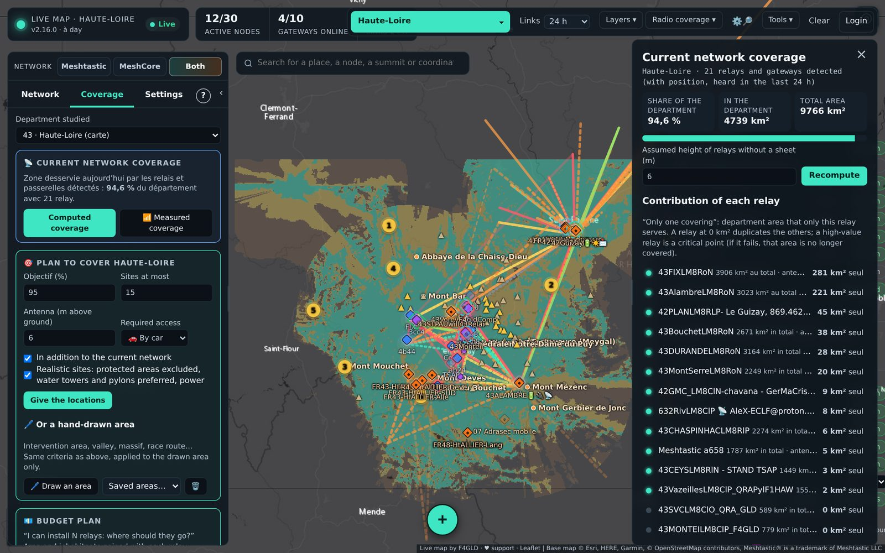

# Coverage and sites

**Coverage** tab and **Radio coverage** menu. Computations use a terrain model at 250 m (820 ft) resolution, calibrated on actually measured links:
- **US counties**: **USGS 3DEP** (The National Map, 1/3 arc-second seamless DEM, public domain), resampled to the 250 m grid by the USGS service. The map's area is a county (5-digit FIPS code, e.g. `04013` = Maricopa County, AZ). If 3DEP is unreachable, the map falls back to Copernicus GLO-30, which also covers the whole US.
- **outside the US**: **Copernicus DEM GLO-30** (ESA, free, worldwide). Areas are **1° × 1° squares** named after their south-west corner (`MN49W123` = 49–50°N, 123–122°W).



The radio frequency used for the computations is set with `RADIO_FREQ_MHZ` in the `.env` (`906.875` = US LongFast by default). Town populations come from OpenStreetMap places, whose US population tags mostly come from the Census. Distances, heights and areas are shown in miles, feet and mi² (*Settings › Display › 📏 Units* switches to metric); input fields stay in metres and kilometres.

- **Current network coverage**: area served by the detected relays, share of the county, what each relay alone covers.
- **Point coverage**: click on the map or on a node; adjustable antenna height. Points near another county automatically use its terrain.
- **Cover one or more points**: sites able to serve a place, or 2 to 5 places with a single relay.
- **Connect two places**: relays needed and where to place them.
- **Plan to cover the county**: goal, number of sites, required access (car, 4×4, on foot); **see the coverage** button on each suggested site.
- **Budget plan**: “I have N relays to install”, area and people gained.
- **“What if…” simulation**: remove or add relays, towns that would no longer be covered.
- **Profile between two points**: height of each antenna **above ground** (mast drawn on the profile, ground and antenna altitude shown), **towers** (OpenStreetMap communication towers, masts and water towers), **move relays**.
- **Installation sheet** of each relay (antenna, height, gain, cable, power, power source): used by the computations.
- **Measured coverage**: where nodes are actually received from, field surveys.
- **Neighbouring bubbles**: relays from the maps of neighbouring counties (*Tools › Share*).

In the MeshCore view, computations use the US/Canada recommended MeshCore setting (910.525 MHz, BW 62.5 kHz, SF7, CR5).

## Hand-drawn area
In *Coverage › Plan*, **🖊 Draw an area** studies a sector rather than the whole county: intervention area, valley, massif, race route…
1. Click on the map to place the area's corners (3 at least). “↶ Point” removes the last one. A point that would make the outline cross itself is refused.
2. **➕ Another area** closes the area and starts another one (10 at most): all are studied together.
3. Give a name if you want, then **Finish and study**. A double-click or a click on the first point does the same.

For the area alone, the map gives:
- the share covered today by the network;
- the high points to equip, in order, with each one's area gain;
- for each one, **other possible locations** (1a, 1b, 1c) with a similar contribution, if the suggested site cannot be used;
- the final coverage (blue: already covered, turquoise: added, red: not covered).

**Antenna (m above ground)**: antenna height of the suggested sites for the drawn area (6 m by default, from 1 to 60 m); it is recalled in the result. The county plan uses the height set by the high point ranking (6 m), shown in its result.

The criteria are those of the county plan: goal, number of sites, access (changeable in the result: car, 4×4, on foot, all), current network, realistic sites. Candidate high points are those of the area and within 10 km around it. The area must stay inside the loaded terrain (the department and its surroundings). Areas are kept in this browser (*Saved areas…*), and the sites' GPX can be downloaded.

## Other counties and the whole state
By default, coverage computations cover the map's county, whose terrain is downloaded at installation. To compute elsewhere:

- **Logged-in accounts**: *Coverage › County studied*; the chosen county's terrain is downloaded at the first computation (a few minutes; large western counties take longer), then kept on the server.
- **Public map**: the administrator chooses in *Manage › Settings › Public map and terrain* between “county of the map only” (light, default) and “any US county”.

### Prepare the whole state
*Tools › 🗺️ Whole state › ⬇ Prepare all of <state>* (also in *Manage › Settings › Public map and terrain*) downloads, county by county, the terrain of every county of the map's state (USGS 3DEP) with its high points, access tracks and sites (OpenStreetMap), so every computation there is immediate. Progress is shown (current county, time left); preparation continues with the page closed, resumes by itself after a restart, and stops in one click. Counties already ready are skipped. Once done, the public map switches **by itself** to “any county”.

### Terrain package (optional)
**📦 Build a terrain package** (same screen) puts every county ready on a server in one `tar.gz`. Another map can install it first by setting `RELIEF_PAQUET_URL=https://…/terrain-package.tar.gz` in its `.env`, or offline:
```bash
docker compose exec carte-live tar -xzf /data/terrain-package.tar.gz -C /data --skip-old-files
```

Sources: USGS 3D Elevation Program (public domain); Copernicus DEM © DLR e.V. / Airbus, provided under COPERNICUS by the EU and ESA; county outlines: US Census Bureau cartographic boundaries; high points, towns, access roads and towers © OpenStreetMap contributors (ODbL); addresses: US Census geocoder.
